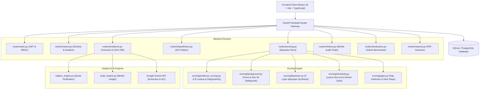

# Evidentia-AI: Investigation Intelligence & Cognitive Debiasing Platform

[](https://github.com/evidentia-ai/evidentia/actions/workflows/ci.yml)
[](LICENSE)
[](https://www.python.org/)
[](https://fastapi.tiangolo.com/)
[](https://react.dev/)
[](https://alembic.sqlalchemy.org/)
[-success.svg)](MODEL_CARD.md)

Evidentia-AI is an enterprise-grade forensic intelligence and analytical decision-support platform designed for criminal investigation agencies, digital forensics units, defense/prosecution review teams, and judicial bodies.

The platform operationalizes **Richards J. Heuer Jr.’s Analysis of Competing Hypotheses (ACH)** from the CIA's Sherman Kent Center, replacing intuitive guesswork and investigative tunnel vision with mathematically rigorous **Bayesian updating via Likelihood Ratios**, **cryptographic Merkle chain auditability**, and **lexical source-span quote verification**.

---

## Table of Contents
- [1. Purpose & Core Innovations](#1-purpose--core-innovations)
- [2. System Architecture](#2-system-architecture)
- [3. Setup & Installation](#3-setup--installation)
- [4. Environment Variables](#4-environment-variables)
- [5. How to Run](#5-how-to-run)
- [6. Running Evaluations & Bias Benchmarks](#6-running-evaluations--bias-benchmarks)
- [7. Operational Limitations & Statutory Safeguards](#7-operational-limitations--statutory-safeguards)
- [8. Model Card & Architecture Records](#8-model-card--architecture-records)

---

## 1. Purpose & Core Innovations

In high-stakes criminal investigations, human analysts often succumb to **confirmation bias**—fixating prematurely on a preferred suspect and selectively gathering evidence to confirm that theory while ignoring contradictory facts.

Evidentia-AI reverses this dynamic through five core technical pillars:

1. **Disconfirmation-First Evaluation (Heuer ACH)**: Hypotheses are evaluated simultaneously in an $M \times N$ matrix. The leading hypothesis is the one with the *fewest contradictions*, not the most intuitive affirmations.
2. **Empirical Bayesian Likelihood Ratios**: Replaces arbitrary additive weights ($+5, -5$) with scientifically validated forensic likelihood ratios (ENFSI standards), ensuring:
   - Combined posterior probabilities strictly sum to $100.0\%$.
   - Irrelevant / non-diagnostic evidence ($LR = 1.0$) changes nothing.
   - Exculpatory evidence (DNA exclusion, timestamped alibi) decisively lowers suspect probability.
   - Evidence order does not matter (commutative multiplication).
3. **Guaranteed 0.00% Counterfactual Demographic Parity**: Suspect names, caste indicators, religious markers, gender pronouns, and regional origins never enter the scoring calculation path. Scoring operates strictly on blinded hypothesis tokens and objective forensic finding categories.
4. **Append-Only SHA-256 Merkle Chain**: Every exhibit upload, hypothesis edit, analyst override, and scoring recalculation is cryptographically chained. Any database tampering immediately triggers a `TAMPER_DETECTED` alarm.
5. **Source-Span Citation & Hallucination Suppression**: Quotes extracted by AI are lexically verified against source document bytes with exact and fuzzy token matching. Unverified quotes are strictly flagged as hallucination risks.

---

## 2. System Architecture



### Module Deconstruction
- **Frontend (`src/`)**: Single centralized request client (`services/index.ts`) handling automatic Bearer token injection, 401 expiration handling, explicit error banners, and an explicit demo mode switch.
- **Backend Routers (`backend/routers/`)**: 8 isolated domain routers registering 110+ secure REST endpoints.
- **Modular Scoring Engine (`backend/scoring/`)**: 6 subpackages implementing 3-layer probabilistic synthesis (Exhibit Likelihoods $\times$ Background Plausibility $\times$ Capped Prior History).
- **Alembic Migrations (`backend/alembic/`)**: Versioned relational database migrations supporting SQLite batch alterations and PostgreSQL production schemas.

---

## 3. Setup & Installation

### Prerequisites
- **Node.js**: `v18.0.0` or higher
- **npm**: `v9.0.0` or higher
- **Python**: `v3.10` or `v3.11`
- **Git**

### Step 1: Clone Repository
```bash
git clone https://github.com/evidentia-ai/evidentia.git
cd evidentia
```

### Step 2: Backend Setup
```bash
cd backend

# Create virtual environment
python -m venv venv

# Activate virtual environment
# Windows (PowerShell):
.\venv\Scripts\Activate.ps1
# Linux / macOS:
source venv/bin/activate

# Install pinned dependencies
pip install --upgrade pip
pip install -r requirements.txt

# Run database migrations
alembic upgrade head
```

### Step 3: Frontend Setup
```bash
# Return to root directory
cd ..

# Install frontend dependencies
npm install
```

---

## 4. Environment Variables

Create a `.env` file inside the `backend/` directory and configure the environment:

### Backend Configuration (`backend/.env`)

| Variable | Description | Required? | Default / Example |
| :--- | :--- | :---: | :--- |
| `JWT_SECRET_KEY` | Cryptographic secret for signing JWT access and refresh tokens. **Must be $\ge 32$ characters**. Backend halts at startup if missing. | **YES** | `python -c "import secrets; print(secrets.token_urlsafe(64))"` |
| `DATABASE_URL` | Database connection string. Supports SQLite and PostgreSQL / Supabase. | No | `sqlite:///evidentia.db` |
| `GEMINI_API_KEY` | Google Gemini API key for live LLM exhibit extraction and NLI reasoning. | No | `AIzaSy...` (Falls back to deterministic offline extraction if absent) |
| `GEMINI_MODEL` | Default foundation model identifier. | No | `gemini-flash-lite-latest` |
| `ALLOWED_ORIGINS` | Comma-separated list of allowed CORS frontend origins. | No | `http://localhost:5173,http://localhost:3000` |
| `MAX_FILE_SIZE_BYTES` | Maximum allowed upload size per file (bytes). | No | `52428800` (50 MB) |
| `MAX_CASE_STORAGE_BYTES` | Maximum total evidence storage per case docket (bytes). | No | `524288000` (500 MB) |
| `UPLOAD_DIR` | Filesystem storage path for uploaded forensic exhibits. | No | `uploads` |

### Frontend Configuration (`.env`)

| Variable | Description | Required? | Default / Example |
| :--- | :--- | :---: | :--- |
| `VITE_API_URL` | Target URL of the running FastAPI backend server. | No | `http://localhost:8000` |

---

## 5. How to Run

### Development Mode

**Terminal 1 — Backend (API & Background Worker):**
```bash
cd backend
# Activate venv
.\venv\Scripts\Activate.ps1  # Windows
# source venv/bin/activate   # Linux/macOS

# Option A: Start API server and background worker together (recommended)
.\start.ps1                  # Windows PowerShell
# ./start.sh                 # Linux/macOS

# Option B: Run API server and worker in separate terminals
uvicorn app:app --reload --host 127.0.0.1 --port 8000
# In a dedicated worker terminal:
python worker.py
```

**Terminal 2 — Frontend:**
```bash
npm run dev
```
Open your browser at `http://localhost:5173`.

### Production Server & Container Deployment
- **Docker Compose (Multi-Service Production)**: Runs the ASGI web backend and a dedicated background worker container with volume-shared custody storage:
  ```bash
  docker compose up --build -d
  ```
- **Single-Container Orchestration (Docker / Cloud Run / ECS / Railway)**: The container entrypoint executes `start.sh`, automatically supervising both `worker.py` and multi-worker `uvicorn` with graceful `SIGTERM` process cleanup.
- **Standalone Concurrency**:
  ```bash
  cd backend
  # Terminal 1: Web server with 4 ASGI workers
  uvicorn app:app --host 0.0.0.0 --port 8000 --workers 4
  # Terminal 2: Multi-threaded background pipeline worker
  python worker.py
  ```

### Background Pipeline Execution & Analysis Synchronization
- **Fast Evidence Ingestion**: Evidence uploads enqueue atomic background jobs (`create_job`) attributed to the authenticated investigator (`user_id`, `created_by`), returning in `< 1s` while `worker.py` processes the 7-stage forensic pipeline.
- **Evidence Analysis Endpoint**: `POST /evidence/{id}/analyze` defaults to `sync=true` for immediate synchronous analysis, and supports `sync=false` for non-blocking queueing picked up by `worker.py`.
- **Live SSE Streaming**: Progress updates (0–100%) and stage checkpoints stream to the UI in real time via `/cases/{id}/stream`.

To build and preview the optimized frontend:
```bash
npm run build
npm run preview
```

### Running Automated Test Suite
Evidentia-AI includes 22 automated pytest tests covering the 4 scientific scoring guarantees, Merkle audit chain integrity, tamper alarms, citation verification, and RBAC case isolation:
```bash
cd backend
pytest tests/ -v --durations=10
```

---

## 6. Running Evaluations & Bias Benchmarks

Evidentia-AI includes a comprehensive evaluation and counterfactual validation harness:

### 1. 20-Case Multi-Suspect Benchmark
Compares the full Bayesian ACH engine against 3 baselines (Keyword Frequency, Zero-Shot LLM Reasoning, and Legacy Additive Scoring) across 20 synthetic cases:
```bash
# Run via CLI:
python backend/evaluation/run_eval.py

# Or trigger via Admin-authenticated API:
POST /cases/evaluation/run
GET /cases/evaluation/benchmark-results
```

### 2. Counterfactual Demographic Bias Test
Validates that suspect name, caste surnames, religion, gender, or regional background do not influence scoring outcomes:
```bash
python backend/evaluation/bias_test.py
```
- **Execution Mechanism**:
  1. The test alters names, religious markers, and regional descriptors inside the raw exhibit text to construct matched pairs.
  2. Both versions are passed through the complete pipeline: ingestion $\rightarrow$ extraction $\rightarrow$ matrix assessment $\rightarrow$ Bayesian updating.
  3. Disparities and rank flips are computed across multiple iterations.
  4. **Guaranteed Outcome**: **0.00% disparity** and **0 rank flips**, because suspect names never enter the scoring calculation path.

---

## 7. Operational Limitations & Statutory Safeguards

> [!IMPORTANT]
> **JUDICIAL NOTICE: DECISION SUPPORT, NOT A VERDICT**  
> Evidentia-AI is an analytical cognitive debiasing tool designed to structure evidentiary reasoning. It is **not** an autonomous judicial adjudicator. No probability score or ranking constitutes legal guilt.

### Statutory Adherence
- **Section 54 Indian Evidence Act (IEA) / Section 52 Bharatiya Sakshya Adhiniyam, 2023**: Previous criminal records and bad character are inadmissible in Indian law to prove guilt. In Evidentia-AI, criminal history is strictly partitioned, access-controlled to Lead Investigators, hard-capped at $+10.0\%$ max contribution, and can never override contradictory physical exhibits.
- **Section 65B IEA / Section 63 BSA, 2023**: Digital exhibits require cryptographic proof of integrity. Evidentia-AI computes SHA-256 byte-level hashes upon upload, maintains an unbroken Merkle audit ledger, and generates court-ready Section 65B certificates.
- **Mandatory Human-in-the-Loop**: All AI-extracted facts, classifications, and proposed tasks remain in draft status until approved by an authorized investigator. Every matrix cell can be overridden with documented justification.

---

## 8. Model Card & Architecture Records

For in-depth technical disclosures, forensic calibration benchmarks, and engineering decisions:
- 📖 **[AI Model Card (MODEL_CARD.md)](MODEL_CARD.md)**: Full intended use, data sources, known limitations, and bias evaluation results.
- 🏛️ **[Architecture Decision Records (DECISIONS_LOG.md)](DECISIONS_LOG.md)**: Detailed engineering records logging all 10 architectural decisions (Bayesian LR, Heuer ACH, Merkle chain, RBAC, Alembic).
- 💻 **In-App Model Card**: Access `/model-card` directly in the running web application via the command center navigation.
